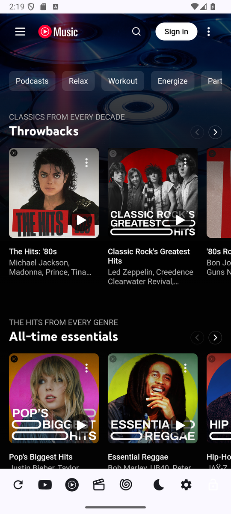
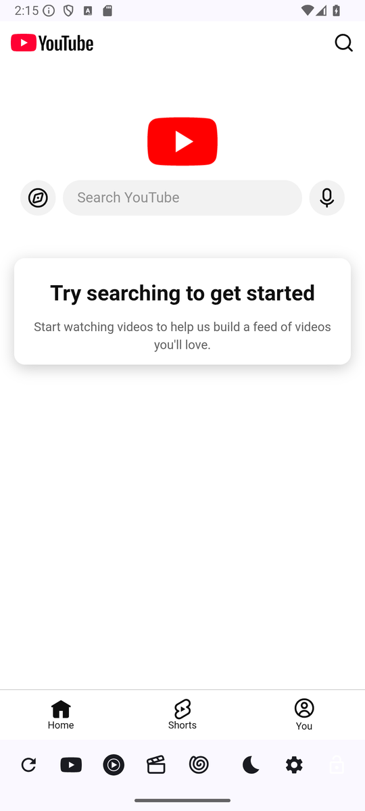
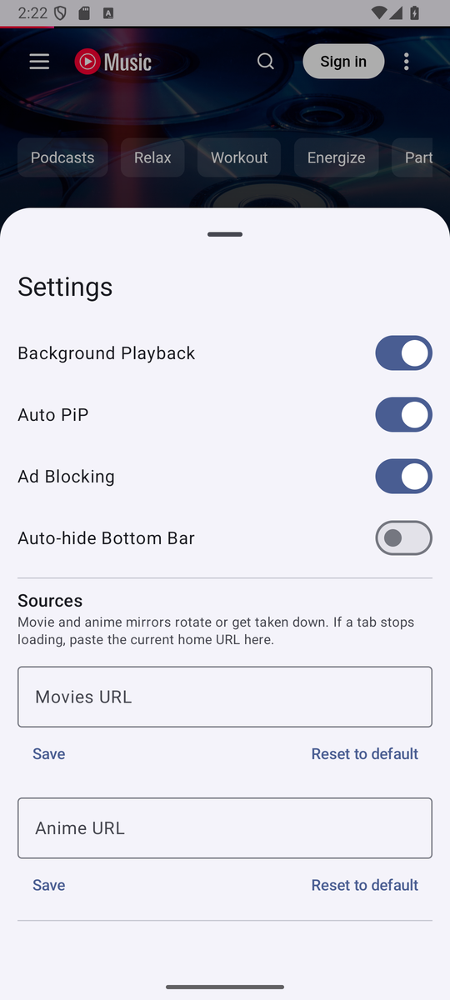
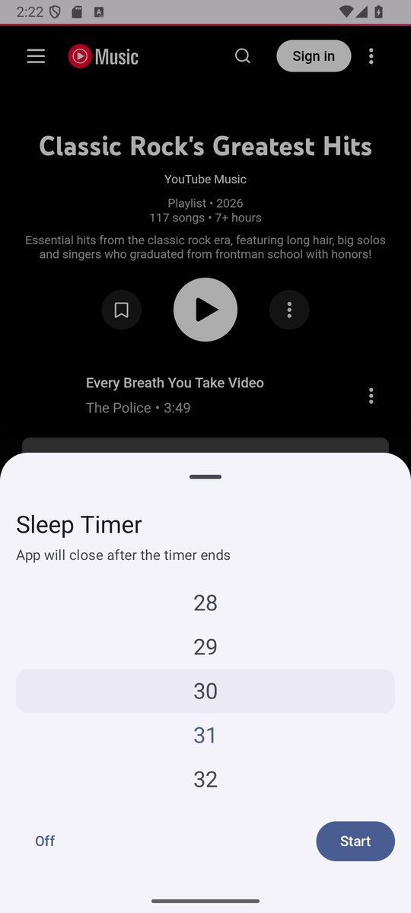
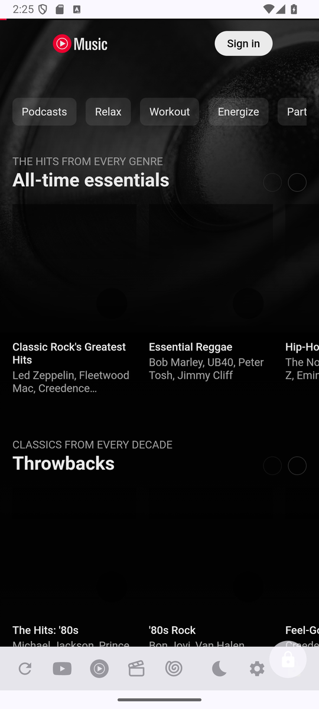
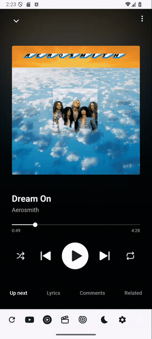
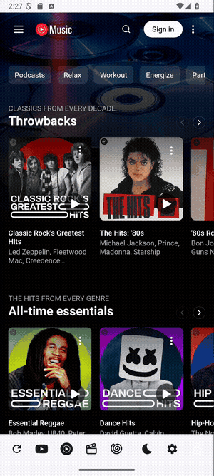
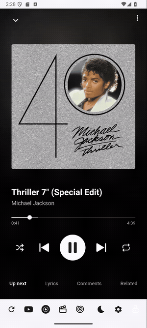
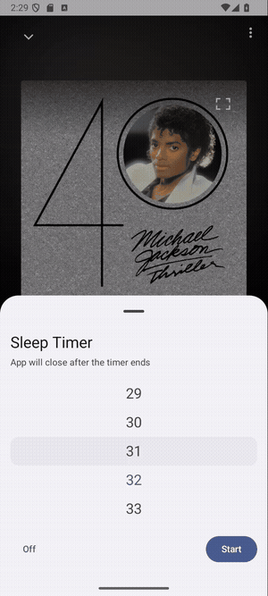

<div align="center">


# MyTube

**An all-in-one Android shell for YouTube, YouTube Music, Movies and Anime — with ad blocking, background playback, sleep timer, screen lock and Picture-in-Picture.**

[](https://github.com/Isaac-1555/MyTube_Android/releases/latest)
[](https://github.com/Isaac-1555/MyTube_Android/releases)
[](#requirements)
[](https://kotlinlang.org)

<a href="https://github.com/Isaac-1555/MyTube_Android/releases/latest"></a>

</div>

---

## Screenshots

| YouTube Music | YouTube | Settings | Sleep Timer | Screen Lock |
| :-----------: | :-----: | :------: | :---------: | :---------: |
|  |  |  |  |  |

## Demos

**Switch between tabs**



**Settings**



**Sleep timer**



**Auto-hide bottom bar**



---

## Features

- **Four tabs in one app** — YouTube, YouTube Music, Movies and Anime.
- **Isolated profiles** — Movies and Anime run in separate WebView profiles, so their cookies/storage never mix with YouTube.
- **Ad blocking** — hosts-based blocking plus uBlock-style scriptlets, with a filter list that updates itself.
- **Background playback** — foreground media service keeps audio running when the screen is off or the app is backgrounded.
- **Rich media controls** — play/pause, real previous/next, stop and artwork-driven tint in the notification and on the lock screen (Android 13+).
- **Home-screen widget** — add the MyTube widget to your launcher for artwork, title and transport controls without opening the app.
- **Picture-in-Picture** — manual PiP and optional auto-PiP when you leave the app; page chrome is hidden so only the video shows.
- **Sleep timer** — 1 to 120 minutes with a snap wheel; the app closes itself when the timer ends.
- **Screen lock** — freeze the page and ignore touches, ideal when handing the phone to someone.
- **Edge-swipe navigation** — swipe from the left edge to go back, right edge to go forward.
- **Auto-hide bottom bar** — the bar fades away after 5s of inactivity and returns on touch.
- **Configurable sources** — if a Movies/Anime mirror rotates or goes down, paste a new home URL in Settings.

## What's New in v2.9.2

- **Home-screen media widget** — add the MyTube widget to your launcher for artwork, title, previous/play-pause/next, without opening the app.
- **Android now recognises MyTube as a media app** — the playback service is a real `MediaBrowserService`, so SystemUI media controls, Bluetooth/headset buttons and the lock screen all drive playback.
- **Media controls fixed** — the session now publishes its state as soon as it starts (previously it went active with no state, which Android ignored), reports a zero playback rate while paused so the scrubber stops drifting, and advertises a play/pause action.
- **Smoother scrubber** — playback position advances every second instead of every ten, so the progress bar moves continuously.
- **Notification polish** — tapping the notification opens the app, and it now shows playback progress without re-alerting on every update.

## Download & Install

Grab the latest signed APK from the **[Releases page](https://github.com/Isaac-1555/MyTube_Android/releases/latest)**.

Direct download: **[MyTube-v2.9.2-release.apk](https://github.com/Isaac-1555/MyTube_Android/releases/download/v2.9.2/MyTube-v2.9.2-release.apk)**

### Install on Android

1. Download the `.apk` file on your phone (or transfer it).
2. When prompted, allow your browser/file manager to **install unknown apps**
   (*Settings → Apps → Special access → Install unknown apps*).
3. Open the APK and tap **Install**.
4. On first launch, grant **notifications** if you want media controls on the lock screen and in the shade.

### Install with ADB

```bash
adb install MyTube-v2.9.2-release.apk
```

### Requirements

- Android **7.0 (API 24)** or newer (`minSdk 24`, `targetSdk 36`).
- An internet connection for streaming.

### Verify the download (optional)

```bash
apksigner verify --print-certs MyTube-v2.9.2-release.apk
```

The release is signed with APK Signature Scheme v2. Certificate SHA-256:

```
EB:37:C6:84:4E:4A:BC:DC:68:D7:63:8C:3D:9C:DA:78:
AE:C5:7A:1E:E1:30:1C:A8:31:4D:C9:F5:84:39:D8:F4
```

---

## Usage

The bottom bar is the only chrome the app draws — everything above it is the real website.

| Icon | Action |
| :--- | :----- |
| ⟳ **Reload** | Reload the current page |
| ▶ **YouTube** | Switch to the YouTube tab |
| Ⓜ **YouTube Music** | Switch to the YouTube Music tab |
| 🎬 **Movies** | Switch to the Movies tab (isolated profile) |
| 🌀 **Anime** | Switch to the Anime tab (isolated profile) |
| 🌙 **Sleep timer** | Set a timer (1–120 min); the remaining time shows next to the icon |
| ⚙ **Settings** | Open the settings sheet |
| 🔒 **Lock** | Freeze the page and block touches; tap the lock chip to unlock |

- **Go back / forward** — swipe in from the left or right edge of the screen.
- **Exit** — swiping back from your first page shows an *Exit MyTube?* dialog.
- **Picture-in-Picture** — leave the app to enter PiP (enable **Auto PiP** in Settings), or use the system gesture.
- **Bottom bar** — hides after 5 seconds when **Auto-hide Bottom Bar** is enabled; tap anywhere to bring it back.
- **Hiding link buttons** — each site button (YouTube, YouTube Music, Movies, Anime) can be switched off individually in Settings. The button for the tab you are currently on always stays visible, so you can never get stranded on a hidden tab.

### Settings

| Setting | Description |
| :------ | :---------- |
| **Background Playback** | Keep audio playing when the app is not in the foreground |
| **Auto PiP** | Automatically enter Picture-in-Picture when you leave the app |
| **Ad Blocking** | Enable hosts + scriptlet based ad blocking |
| **Auto-hide Bottom Bar** | Hide the bottom controls after a few seconds of inactivity |
| **YouTube Button** | Show the YouTube link in the bottom bar |
| **YouTube Music Button** | Show the YouTube Music link in the bottom bar |
| **Movies Button** | Show the Movies link in the bottom bar |
| **Anime Button** | Show the Anime link in the bottom bar |
| **Movies URL / Anime URL** | Override the mirror used by the Movies and Anime tabs |

> Movies and Anime rely on public streaming mirrors that rotate or get taken down. If a tab stops loading, open **Settings** and paste the current home URL.

---

## Build from source

### Requirements

- JDK 17 or newer
- Android SDK with **build-tools 36.0.0** and **platform 36**
- `local.properties` pointing at your SDK (`sdk.dir=/path/to/Android/sdk`)

### Debug build

```bash
./gradlew assembleDebug
# app/build/outputs/apk/debug/app-debug.apk
```

### Release build (signed)

Create `keystore.properties` in the project root:

```properties
storeFile=mytube-release.jks
storePassword=********
keyAlias=mytube
keyPassword=********
```

Then build:

```bash
./gradlew assembleRelease
# app/build/outputs/apk/release/app-release.apk
```

`keystore.properties`, `*.jks` and `*.keystore` are git-ignored — never commit your signing keys.

## Changelog

### v2.9.2 — 2026-10-17

- Playback: promote the service to `MediaBrowserService` so Android treats MyTube as a media app
- Playback: publish playback state and metadata as soon as the session starts, not only on the first metadata update
- Playback: report a 0f rate while paused so the system scrubber stops drifting forward
- Playback: advertise `ACTION_PLAY_PAUSE` so SystemUI renders the toggle
- Playback: extrapolate the position from the last WebView sample between reports
- Playback: register `MediaButtonReceiver` and handle `MEDIA_BUTTON`; keep playing when the task is swiped away
- Playback: add a home-screen widget with artwork, title and previous/play-pause/next
- Notification: add a content intent, progress bar and alert-once behaviour
- Playback: report position every second instead of every ten

### v2.9.0 — 2026-10-17

- Adblock: clear YT Music promo backdrop that blocks taps

### v2.8.9 — 2026-10-08

- Adblock: plug YouTube feed and video ad leaks
- Adblock: block movie/anime popups and ad navigation
- Per-tab history for YouTube Music
- Responsive bottom-bar icon sizing
- Theme-adaptive lock icon colors
- Playback: don't resume paused video on background

### v2.0.0 — 2026-09-30

- Movies and Anime tabs with isolated WebView profiles
- Rich media controls: real prev/next and artwork tint (Android 13+)
- Edge-swipe navigation, screen lock, video-only PiP
- Auto-hide bottom bar
- README with screenshots and demo gifs

## Tech stack

- **Kotlin** + **Jetpack Compose** (Material 3) UI
- **AndroidX WebKit** WebViews with per-tab profiles
- **MediaSession / MediaBrowserService** foreground service, so Android, Bluetooth and the widget can all drive playback
- **DataStore** preferences and **Room**-backed script storage
- **Palette** for artwork-tinted media controls
- Gradle **9.7.1**, Android Gradle Plugin **9.4.1**

## Disclaimer

MyTube is an unofficial wrapper and is not affiliated with, endorsed by, or sponsored by YouTube or Google. It renders third-party websites; availability of those sites is outside this project's control. Respect the terms of service and the laws that apply to you.

## License

No license is currently provided for this repository.
