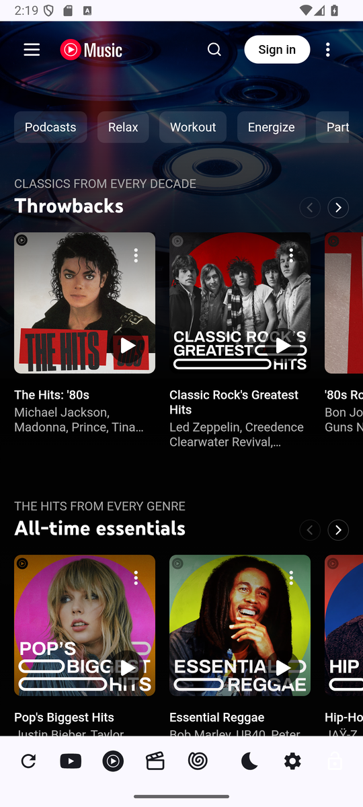
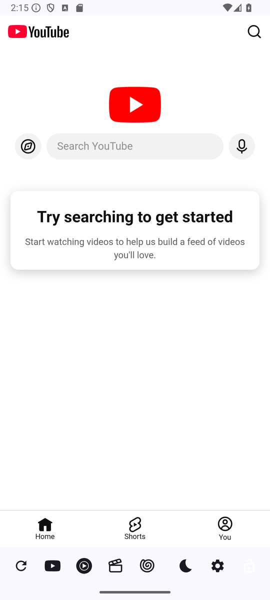
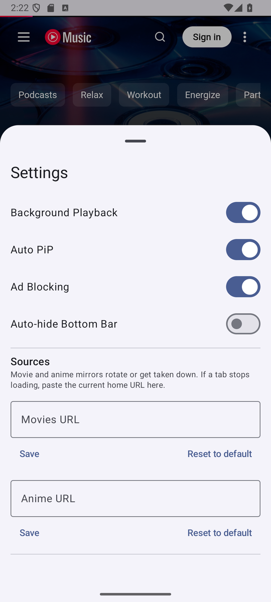
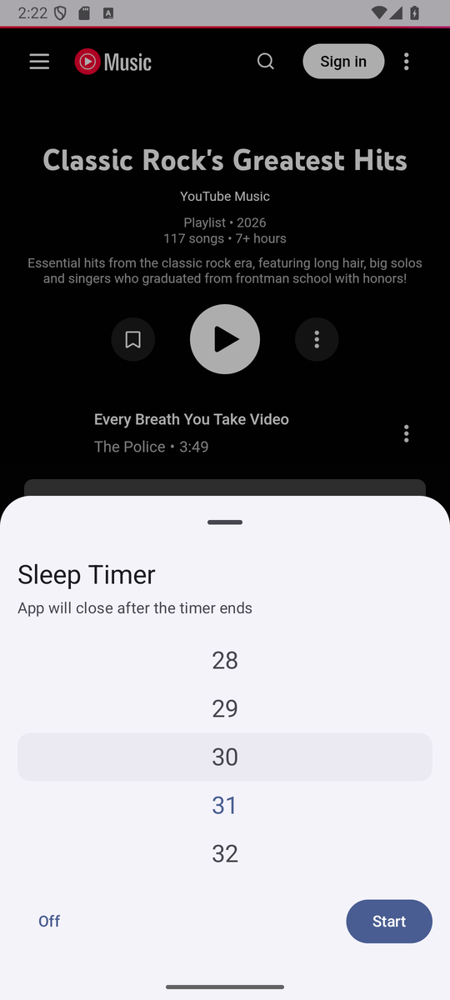
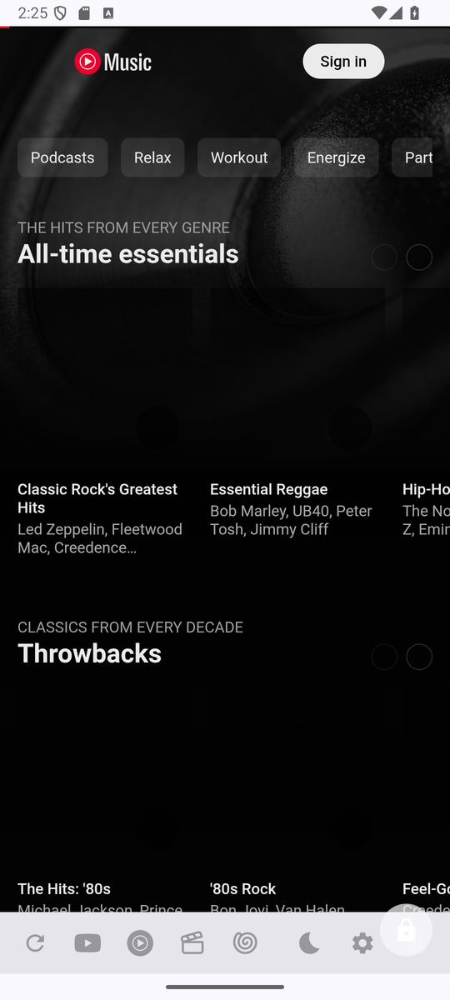
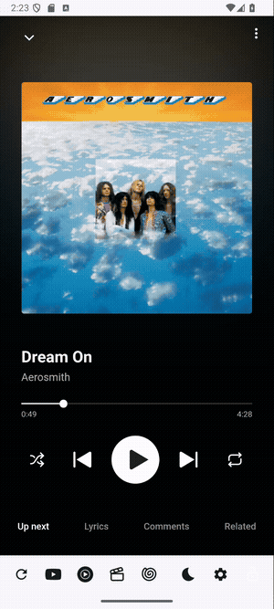
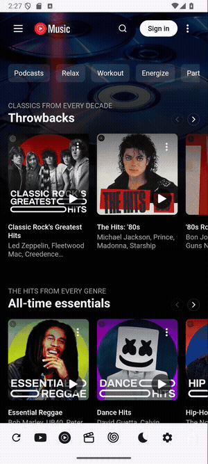
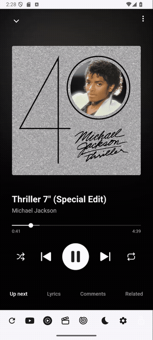
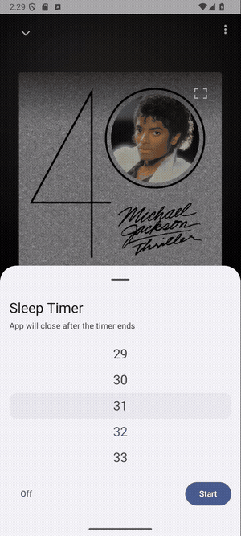

<div align="center">


# MyTube

**An all-in-one Android shell for YouTube, YouTube Music, Movies and Anime — with ad blocking, background playback, sleep timer, screen lock and Picture-in-Picture.**

[](https://github.com/Isaac-1555/MyTube_Android/releases/latest)
[](https://github.com/Isaac-1555/MyTube_Android/releases)
[](#requirements)
[](https://kotlinlang.org)

<a href="https://github.com/Isaac-1555/MyTube_Android/releases/latest"></a>

</div>

---

## Screenshots

| YouTube Music | YouTube | Settings | Sleep Timer | Screen Lock |
| :-----------: | :-----: | :------: | :---------: | :---------: |
|  |  |  |  |  |

## Demos

**Switch between tabs**



**Settings**



**Sleep timer**



**Auto-hide bottom bar**



---

## Features

- **Four tabs in one app** — YouTube, YouTube Music, Movies and Anime.
- **Isolated profiles** — Movies and Anime run in separate WebView profiles, so their cookies/storage never mix with YouTube.
- **Ad blocking** — hosts-based blocking plus uBlock-style scriptlets, with a filter list that updates itself.
- **Background playback** — foreground media service keeps audio running when the screen is off or the app is backgrounded.
- **Rich media controls** — play/pause, real previous/next, stop and artwork-driven tint in the notification and on the lock screen (Android 13+).
- **Home-screen widget** — add the MyTube widget to your launcher for artwork, title and transport controls without opening the app.
- **Picture-in-Picture** — manual PiP and optional auto-PiP when you leave the app; page chrome is hidden so only the video shows.
- **Rotate to fullscreen landscape** — turn the phone while a YouTube video is playing and the video fills the screen in landscape, with the system bars and page chrome hidden. Rotating back returns to portrait.
- **Sleep timer** — 1 to 120 minutes with a snap wheel; the app closes itself when the timer ends.
- **Screen lock** — freeze the page and ignore touches, ideal when handing the phone to someone. Also available from inside fullscreen.
- **Edge-swipe navigation** — swipe from the left edge to go back, right edge to go forward.
- **Auto-hide bottom bar** — the bar fades away after 5s of inactivity and returns on touch.
- **Configurable sources** — if a Movies/Anime mirror rotates or goes down, paste a new home URL in Settings; the tab moves there at once.

## What's New in v2.11.1

The PiP window plays properly now — the picture, the sound and the notification all keep still.

- **The PiP window no longer stutters or re-buffers.** YouTube's own player pauses the video by itself when the window becomes a PiP window, and it pauses it again after every play. MyTube was resuming the video, YouTube was pausing it again, and the two fought over it several times a second. That fight was the stutter: every cycle restarted the audio and made the player re-seek and re-buffer. The pause is now refused in a PiP window, unless you ask for it — a tap in the window and the notification still pause it as they should.
- **The notification stopped flipping between pause and play.** The pause that the app undoes is not reported, and a pause is confirmed before it is announced, so the media card says "playing" and means it.
- **Background playback was fighting the browser too.** Chromium reads a page's visibility from a callback the app was not overriding, so the browser paused the media every time the window went away. The page is now reported as visible while the playback is meant to run.
- **Less churn in the page.** The rule that hides the page around the video no longer touches the player's own elements — it could hide the video itself — and it only rewrites what actually changed. The observer that watches the page runs once per frame instead of once per change, and the player model is worked out a few times a second rather than on every change YouTube makes to the page.
- **The right video is watched.** After a player rebuild the first `<video>` in the document is the old, paused one, so the app used to report "playback stopped" and resume the wrong element.
- **Less traffic to the app.** The playback position is reported in five-second steps instead of one, and a PiP window is no longer treated as a background state, so the heartbeat and the page tick do not run against it.

Verified on device (Pixel, Android 16): dropped frames 0/1151 in the PiP window, the position advances without a break, and the notification makes no pause/play transitions.

## What's New in v2.11.0

Fullscreen and PiP rebuilt against the player YouTube actually ships now — and a source set in Settings finally does something.

- **The settings overlay shows in fullscreen.** YouTube's quality/resolution panel is a dialog that sits *next to* the page, not inside the player. The rule that hides the page around the video took it with everything else, so the panel never appeared. Overlays are now recognised, kept, and lifted above the picture.
- **Rotating back to portrait lines up again.** Leaving fullscreen forced YouTube out of its own fullscreen before the page had actually left it, and the page was never told that the window had changed shape — so it kept the landscape picture. It now leaves fullscreen on its own terms, and the layout is refreshed once the rotation lands.
- **A new Anime or Movies URL takes effect at once.** The tab used to carry on showing the old site, because it keeps its own WebView for the whole session. Saving a source now moves the tab to that URL, drops the cached copy of the old site, and stops the old one from being resumed on the next start. A source without a scheme gets `https://` so the WebView will load it at all.
- **PiP shows only the video again.** The page chrome is hidden in the PiP window as it was, and the small window no longer zooms the page out to fit, so the video fills it instead of sitting beside the page layout.
- **Less churn in the small window.** The player is re-pinned on a timer instead of on every change YouTube makes to the page — which is where the micro-stutter in the PiP audio came from.

## What's New in v2.10.2

Housekeeping. No behaviour change.

- **Android Lint passes again.** `./gradlew lint` had been failing since the rotate-to-fullscreen work on an `UnsafeOptInUsageError` in the per-tab profile WebView builder. The experimental marker on that API is an AndroidX opt-in rather than a Kotlin one, so the Kotlin `@OptIn` doing the job was a no-op to the compiler — it was warning about that on every build — and lint was still flagging the call site. The AndroidX form is used instead, which silences both without pushing the opt-in out to every caller.
- **Cleaner repository.** Release APKs are now ignored instead of piling up untracked at the repo root, as is the whole `.idea` directory. Neither was ever meant to be committed.

## What's New in v2.10.1

A fix release for rotate-to-fullscreen, which shipped in v2.10.0 without a working player UI.

- **The media controls and seek bar actually work now.** They were being covered and hidden by MyTube's own fullscreen styling: the player element was pinned above the mobile-web player's control bar and the whole page was hidden with `visibility`, which also hid the bar underneath it. YouTube's control bar is now stacked above the player and the rest of the page is hidden without touching `visibility`.
- **Tapping the video no longer drops you out of fullscreen.** Pausing reported "nothing to watch", so MyTube read your own pause as a reason to leave fullscreen. Fullscreen now holds for as long as a watch page has a video, playing or paused.
- **Double-tap to skip 10 seconds works** — tap the left or right third of the screen to jump back or forward, same as YouTube itself.
- **A lock button in fullscreen** — top right. YouTube's mobile-web player has no lock control at all, so this is MyTube's: it clears YouTube's controls so you cannot change anything by leaning on the screen, and tapping it again brings them back. The lock is also available inside fullscreen now instead of throwing you back to portrait.
- **The controls fade again** after a few seconds, as they do on YouTube. A first attempt at the fix above pinned them visible, which is exactly the property YouTube's own fade is built on.
- **One exit button, not two** — MyTube's corner **✕** now stands down once YouTube is drawing its own fullscreen controls.

Under the hood, rotate-to-fullscreen no longer fakes it: MyTube taps YouTube's own fullscreen button for you, so YouTube enters its real fullscreen and renders its real controls. `requestFullscreen()` refuses to run without a user gesture, which `evaluateJavascript` cannot manufacture, but a touch dispatched through the normal input pipeline is indistinguishable from a real one to the browser. The page is asked to grow its player only as a fallback for the moment before that tap lands.

> The experimental **Use native video fullscreen** switch is gone. It selected a path that could not work — a fullscreen request with no gesture behind it — and it is now what the feature does unconditionally.

## What's New in v2.10.0

- **Rotate to fullscreen landscape** — play a YouTube video, turn the phone, and the video goes edge-to-edge in landscape with the status bar, navigation bar and the YouTube masthead all hidden. YouTube's own controls, seek bar and double-tap 10-second seek all come with it. Turn it back and you land in portrait again.
- **Three modes in Settings** — **Off**, **Rotate to landscape** (default), or **Always landscape** if you would rather it stay in fullscreen for the whole video, YouTube-app style.
- **Reliable exit** — the corner **✕**, the back button, rotating to portrait, switching tabs, leaving the app and entering PiP all leave fullscreen cleanly. You can't get stranded in landscape.
- **Fullscreen on the YouTube tab only** — Movies and Anime mirrors use unrelated players, so they keep their normal layout.

> Previous attempts at this relied on the browser's `screen.orientation.lock()` and `requestFullscreen()`. Both are gated behind a transient user gesture inside WebView, which is why they only worked occasionally. This release decides everything natively and never asks the page for permission.


## What's New in v2.9.2

- **Home-screen media widget** — add the MyTube widget to your launcher for artwork, title, previous/play-pause/next, without opening the app.
- **Android now recognises MyTube as a media app** — the playback service is a real `MediaBrowserService`, so SystemUI media controls, Bluetooth/headset buttons and the lock screen all drive playback.
- **Media controls fixed** — the session now publishes its state as soon as it starts (previously it went active with no state, which Android ignored), reports a zero playback rate while paused so the scrubber stops drifting, and advertises a play/pause action.
- **Smoother scrubber** — playback position advances every second instead of every ten, so the progress bar moves continuously.
- **Notification polish** — tapping the notification opens the app, and it now shows playback progress without re-alerting on every update.

## Download & Install

Grab the latest signed APK from the **[Releases page](https://github.com/Isaac-1555/MyTube_Android/releases/latest)**.

Direct download: **[MyTube-v2.11.1-release.apk](https://github.com/Isaac-1555/MyTube_Android/releases/download/v2.11.1/MyTube-v2.11.1-release.apk)**

### Install on Android

1. Download the `.apk` file on your phone (or transfer it).
2. When prompted, allow your browser/file manager to **install unknown apps**
   (*Settings → Apps → Special access → Install unknown apps*).
3. Open the APK and tap **Install**.
4. On first launch, grant **notifications** if you want media controls on the lock screen and in the shade.

### Install with ADB

```bash
adb install MyTube-v2.11.1-release.apk
```

### Requirements

- Android **7.0 (API 24)** or newer (`minSdk 24`, `targetSdk 36`).
- An internet connection for streaming.

### Verify the download (optional)

```bash
apksigner verify --print-certs MyTube-v2.11.1-release.apk
```

The release is signed with APK Signature Scheme v2. Certificate SHA-256:

```
EB:37:C6:84:4E:4A:BC:DC:68:D7:63:8C:3D:9C:DA:78:
AE:C5:7A:1E:E1:30:1C:A8:31:4D:C9:F5:84:39:D8:F4
```

---

## Usage

The bottom bar is the only chrome the app draws — everything above it is the real website.

| Icon | Action |
| :--- | :----- |
| ⟳ **Reload** | Reload the current page |
| ▶ **YouTube** | Switch to the YouTube tab |
| Ⓜ **YouTube Music** | Switch to the YouTube Music tab |
| 🎬 **Movies** | Switch to the Movies tab (isolated profile) |
| 🌀 **Anime** | Switch to the Anime tab (isolated profile) |
| 🌙 **Sleep timer** | Set a timer (1–120 min); the remaining time shows next to the icon |
| ⚙ **Settings** | Open the settings sheet |
| 🔒 **Lock** | Freeze the page and block touches; tap the lock chip to unlock |

- **Go back / forward** — swipe in from the left or right edge of the screen.
- **Exit** — swiping back from your first page shows an *Exit MyTube?* dialog.
- **Fullscreen** — with a YouTube video playing, rotate the phone to fill the screen in landscape. Rotate back to leave, or use the corner **✕** / the back button.
- **Picture-in-Picture** — leave the app to enter PiP (enable **Auto PiP** in Settings), or use the system gesture.
- **Bottom bar** — hides after 5 seconds when **Auto-hide Bottom Bar** is enabled; tap anywhere to bring it back.
- **Hiding link buttons** — each site button (YouTube, YouTube Music, Movies, Anime) can be switched off individually in Settings. The button for the tab you are currently on always stays visible, so you can never get stranded on a hidden tab.

### Settings

| Setting | Description |
| :------ | :---------- |
| **Background Playback** | Keep audio playing when the app is not in the foreground |
| **Auto PiP** | Automatically enter Picture-in-Picture when you leave the app |
| **Ad Blocking** | Enable hosts + scriptlet based ad blocking |
| **Auto-hide Bottom Bar** | Hide the bottom controls after a few seconds of inactivity |
| **Video Fullscreen** | `Off`, `Rotate to landscape` (default) or `Always landscape` |
| **YouTube Button** | Show the YouTube link in the bottom bar |
| **YouTube Music Button** | Show the YouTube Music link in the bottom bar |
| **Movies Button** | Show the Movies link in the bottom bar |
| **Anime Button** | Show the Anime link in the bottom bar |
| **Movies URL / Anime URL** | Override the mirror used by the Movies and Anime tabs |

> Movies and Anime rely on public streaming mirrors that rotate or get taken down. If a tab stops loading, open **Settings** and paste the current home URL.

---

## Build from source

### Requirements

- JDK 17 or newer
- Android SDK with **build-tools 36.0.0** and **platform 36**
- `local.properties` pointing at your SDK (`sdk.dir=/path/to/Android/sdk`)

### Debug build

```bash
./gradlew assembleDebug
# app/build/outputs/apk/debug/app-debug.apk
```

### Release build (signed)

Create `keystore.properties` in the project root:

```properties
storeFile=mytube-release.jks
storePassword=********
keyAlias=mytube
keyPassword=********
```

Then build:

```bash
./gradlew assembleRelease
# app/build/outputs/apk/release/app-release.apk
```

`keystore.properties`, `*.jks` and `*.keystore` are git-ignored — never commit your signing keys.

## Changelog

### v2.11.1 — 2026-11-14

- Fix: the PiP window stuttered and re-buffered. YouTube's player pauses the video by itself when the window becomes a PiP window and pauses it again after every play, so the app and the page fought over the video several times a second - every cycle restarted the audio and made the player re-seek and re-buffer. The pause is refused in a PiP window unless the watcher asked for it
- Fix: the media notification flipped between pause and play several times a second. The pause that the app undoes is not reported to the app, and a pause is confirmed before it is announced
- Fix: background playback fought the browser. Chromium reads a page's visibility from `onVisibilityAggregated`, which the app did not override, so the browser paused the media whenever the window went away - the app resumed it, and the two fought over it
- Fix: the rule that hides the page around the video could hide the player's own elements, the video included, which restarted the stream
- Perf: the page observer runs once per frame instead of once per change, the player model is cached, the overlay refresh is throttled, and the page sweep only rewrites what actually changed instead of restoring and re-hiding every element on the page
- Fix: the app watched the first `<video>` in the document, which after a player rebuild is the old, paused one, so playback was reported as stopped and the stale element was resumed
- Perf: the playback position is reported in five-second steps instead of one, and a PiP window is no longer treated as a background state, so the service heartbeat and the page tick do not run against it
- Build: the WebView's overview mode is set once per tab instead of being switched when the PiP window opens, which re-laid-out the whole page with the video playing

### v2.11.0 — 2026-11-14

- Fix: the quality/resolution sheet never appeared in fullscreen. YouTube's overlay is a dialog that sits next to the page rather than inside the player, and the rule that hides the page around the video took it with everything else. Overlays are now recognised by role, kept, and lifted above the picture
- Fix: rotating back to portrait left the video hanging off the screen. The teardown forced the custom view down while the page still believed it was fullscreen, and the page was never told that the window had changed shape. The page now leaves fullscreen on its own terms, with a forced fallback, and the layout is refreshed once the rotation lands
- Fix: a source set in Settings had no effect at all. The tab kept its own WebView for the whole session and carried on showing the old site, and the last visited page won over the configured home. A source now owns the tab: it opens that URL, the cached copy of the old site is dropped, and the old site is no longer resumed on the next start
- Fix: a source typed without a scheme ("hianimes.se") was loaded as a cleartext address and refused with `ERR_CLEARTEXT_NOT_PERMITTED`. Sources are given an `https://` scheme when they are saved
- Fix: the PiP window showed the page layout next to the video again, because the unified stylesheet dropped the hide-the-page rule PiP had
- Fix: PiP zoomed the page out to fit its minimum width, which is how the related-videos sidebar appeared next to the video. The overview mode is off while PiP is on, so the layout viewport is the width of the window and the video fills it
- Perf: the player is re-pinned on a timer rather than on every mutation of the page, and the page sweep only hides what was just added. The full sweep restores and re-applies `display` on every element it touches, which on a page that rewrites itself several times a second is a lot of style work - and it is audible in the PiP audio
- Browser: rebuild the fullscreen layer against the player YouTube ships now. The control bar is no longer in `#player-control-overlay`, the container holds both the video and the chrome so the two cannot drift apart, and the video is laid out against the container instead of being offset by YouTube's own left/right insets
- Browser: the fullscreen button lookup now walks open shadow roots, and the diagnostics report the player model that was actually found rather than the one that was assumed
- Tests: 17 unit tests over the source-URL precedence

### v2.10.2 — 2026-10-18

- Build: fix `UnsafeOptInUsageError`; use `androidx.annotation.OptIn` for the WebView builder's AndroidX opt-in marker, which also clears the standing `kotlinc` warning that the Kotlin `@OptIn` there had no effect
- Build: `./gradlew lint` green again; it had been failing since v2.10.0
- Repo: ignore release APKs and `.idea/` so they stop accumulating untracked at the root

### v2.10.1 — 2026-10-18

- Fix: `ytp-fullscreen`-gated chrome never appeared because the CSS pinned `#movie_player` above `#player-control-overlay`, the sibling that holds the mobile-web player's control bar, seek bar and fullscreen button
- Fix: hide everything outside the player chain with `display:none` on the siblings rather than `visibility:hidden` over the page; YouTube fades its own control bar with `visibility`, and a blanket `visibility: visible !important` over the player subtree defeated that permanently
- Fix: tapping to pause tore down fullscreen, because `VideoState.isWatchable` required `isPlaying` and a pause read as "nothing to watch"
- Fix: double-tap to skip 10 seconds was unavailable with no fullscreen chrome to drive it
- Feature: lock control inside fullscreen; YouTube's mobile-web player has no lock element in any state, so it is supplied by the app
- Fix: input lock no longer forces an exit from fullscreen, which is what made the new lock control unusable
- Fix: the app's own exit ✕ no longer stacks on top of YouTube's once YouTube is in its own fullscreen
- Fix: make `isCssFullscreen` and `isNativeFullscreen` Compose-observable; they were plain `var`s, so anything reading them never recomposed
- Fix: rate-limit the fullscreen DOM audit, which ran six `elementsFromPoint` probes plus computed-style reads on every play/pause/seek report
- Browser: hand fullscreen to YouTube rather than imitating it — tap its own fullscreen button with a synthesised touch, which Blink treats as real input and therefore as the user activation `requestFullscreen()` demands
- Browser: locate the button by its accessible label; the mobile-web player has no `.ytp-fullscreen-button` and every class-based selector matched nothing
- Browser: retry the hand-off while YouTube rebuilds the player around the rotation
- Cleanup: remove the `Use native video fullscreen` setting and the gesture-less fullscreen attempt chain behind it
- Tests: 23 unit tests, covering the pause-must-not-exit and lock-must-not-exit regressions

### v2.10.0 — 2026-10-17

- Feature: rotate-to-fullscreen landscape for YouTube video, decided natively rather than through the web fullscreen API
- Feature: `Off` / `Rotate to landscape` / `Always landscape` setting, plus an opt-in native-fullscreen switch
- Feature: fullscreen exit via the corner ✕, the back button, rotation to portrait, tab switch, app backgrounding and PiP entry
- Browser: hide everything outside the player element in fullscreen instead of relying on a selector list or a z-index contest
- Browser: unify the PiP and fullscreen stylesheets into one `<style>` element; they previously both pinned the player with `!important` and fought over it
- Browser: report video presence, watch-page and playback state from the page, pushing on `play`/`pause`/`yt-navigate-finish` instead of a 1.5s poll
- Browser: keep the fullscreen CSS pinned through a `MutationObserver` so YouTube re-renders cannot wipe it mid-rotation
- Browser: address fullscreen teardown to a specific tab rather than the active one, so switching tabs mid-fullscreen cannot strand the CSS
- Fix: `WebViewManager.isFullscreen` read a non-observable field, so nothing observing it ever recomposed
- Fix: wire up `hideCustomView()`, which was defined but never called, and add a fullscreen branch to the back handler
- Fix: pin orientation before hiding the system bars; the previous order was undone by the orientation relayout
- Fix: re-hide the system bars on a guarded poll, since a matching requested orientation dispatches no configuration change at all
- Use the compat insets accessor; the platform `WindowInsets.isVisible` needs API 30 while the app supports 24
- Tests: 22 unit tests over the fullscreen decision matrix

### v2.9.2 — 2026-10-17

- Playback: promote the service to `MediaBrowserService` so Android treats MyTube as a media app
- Playback: publish playback state and metadata as soon as the session starts, not only on the first metadata update
- Playback: report a 0f rate while paused so the system scrubber stops drifting forward
- Playback: advertise `ACTION_PLAY_PAUSE` so SystemUI renders the toggle
- Playback: extrapolate the position from the last WebView sample between reports
- Playback: register `MediaButtonReceiver` and handle `MEDIA_BUTTON`; keep playing when the task is swiped away
- Playback: add a home-screen widget with artwork, title and previous/play-pause/next
- Notification: add a content intent, progress bar and alert-once behaviour
- Playback: report position every second instead of every ten

### v2.9.0 — 2026-10-17

- Adblock: clear YT Music promo backdrop that blocks taps

### v2.8.9 — 2026-10-08

- Adblock: plug YouTube feed and video ad leaks
- Adblock: block movie/anime popups and ad navigation
- Per-tab history for YouTube Music
- Responsive bottom-bar icon sizing
- Theme-adaptive lock icon colors
- Playback: don't resume paused video on background

### v2.0.0 — 2026-09-30

- Movies and Anime tabs with isolated WebView profiles
- Rich media controls: real prev/next and artwork tint (Android 13+)
- Edge-swipe navigation, screen lock, video-only PiP
- Auto-hide bottom bar
- README with screenshots and demo gifs

## Tech stack

- **Kotlin** + **Jetpack Compose** (Material 3) UI
- **AndroidX WebKit** WebViews with per-tab profiles
- **MediaSession / MediaBrowserService** foreground service, so Android, Bluetooth and the widget can all drive playback
- **DataStore** preferences and **Room**-backed script storage
- **Palette** for artwork-tinted media controls
- Gradle **9.7.1**, Android Gradle Plugin **9.4.1**

## Disclaimer

MyTube is an unofficial wrapper and is not affiliated with, endorsed by, or sponsored by YouTube or Google. It renders third-party websites; availability of those sites is outside this project's control. Respect the terms of service and the laws that apply to you.

## License

No license is currently provided for this repository.
